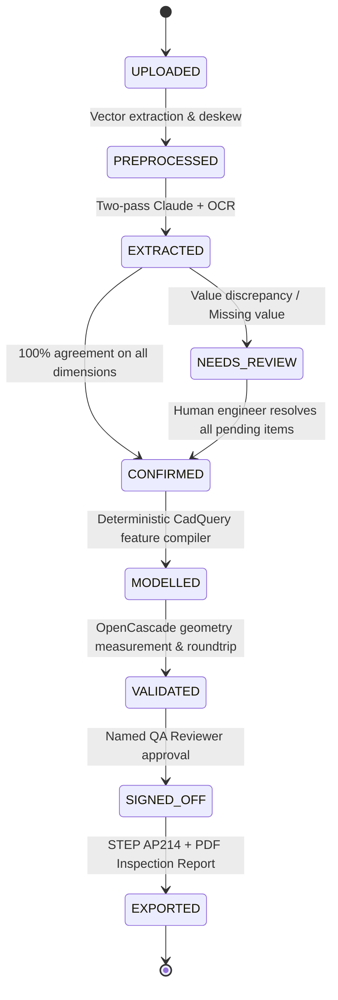

# Sketch2STEP Enterprise Architecture

## 1. System Overview

Sketch2STEP Enterprise converts 2D engineering drawings (PDF, DXF, PNG, JPG) into verified parametric 3D STEP solid models for machining and manufacturing enterprises.

### The Accuracy Invariant
> **No dimension reaches the STEP file unless it was verified by multi-pass cross-check or confirmed by a human; and the final model is measured and compared back against the confirmed spec.**

## 2. Component Topology

- **Frontend (`/apps/web`)**: Next.js 15 (App Router), React 19, Tailwind CSS v4, Lucide icons, IBM Plex typography, Three.js 3D viewer.
- **API Service (`/apps/api`)**: Python 3.11, FastAPI, Pydantic v2, SQLAlchemy 2 async, multi-tenant row-level security.
- **Worker (`/apps/worker`)**: ARQ Redis background jobs executing preprocessing, AI inference, and CAD validation.
- **CAD Feature Compiler (`/packages/cad`)**: Deterministic library of tested CadQuery/OpenCascade geometric builders.
- **Specification Engine (`/packages/spec`)**: Shared Pydantic data contracts and TypeScript definitions.
- **Infrastructure (`/infra`)**: Docker Compose, PostgreSQL 16 (with RLS), Redis 7, MinIO (S3 compatible).
