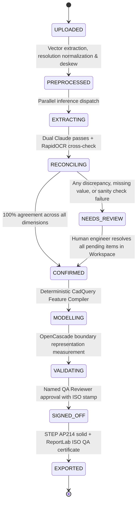

# Sketch2STEP Enterprise — Architectural Specification

## 1. System Overview & The Accuracy Invariant

**Sketch2STEP Enterprise** is a high-assurance, multi-tenant B2B SaaS platform engineered for CNC machining, sheet metal, and precision fabrication enterprises. It bridges the gap between legacy 2D engineering drawings (PDF, DXF, TIFF, PNG, JPG) and manufacturing-ready 3D STEP models (ISO 10303 AP214 / AP242).

### The Prime Accuracy Invariant
> *"No dimension reaches the STEP file unless it was independently cross-checked by two vision passes and OCR, or verified and confirmed by a human engineer; and the final model is physically measured and compared back against the confirmed spec."*

We reject silent guessing, hallucinated geometry, and unverified AI outputs. If a dimension is missing, illegible, or ambiguous, CAD generation is strictly blocked until an engineer inputs or confirms the value in the Review Workspace.

---

## 2. End-to-End Pipeline State Machine



---

## 3. Component Architecture & Repository Topology

The monorepo is structured for strict separation of concerns, high-assurance CAD math, and clean dependency boundaries:

```
├── apps/
│   ├── api/             # FastAPI REST backend with Row-Level Security (RLS)
│   ├── web/             # Next.js 15 App Router, React 19, Three.js 3D viewport
│   └── worker/          # ARQ asynchronous pipeline workers (CadQuery/OCR)
├── packages/
│   ├── cad/             # Deterministic Feature Compiler, OpenCascade validator, ReportLab QA
│   └── spec/            # Pydantic v2 schemas + generated TypeScript interfaces
├── eval/                # 30-part synthetic benchmark dataset & accuracy regression runner
├── infra/               # Docker Compose, Postgres init, on-prem air-gapped configuration
└── docs/                # Architecture, security, API reference, and deployment runbooks
```

### Key Subsystems:

### 3.1. Dual-Pass AI Extraction & OCR Reconciliation
1. **Pass A (Claude 3.5 Sonnet)**: Extracts drawing metadata, title block, and dimension hierarchy with bounding boxes.
2. **Pass B (Claude 3.5 Sonnet / Independent Prompt)**: Extracts features, coordinate references, and tolerance bands.
3. **RapidOCR Line Scanner**: Extracts raw text blocks and numerical strings directly from raster coordinates.
4. **Reconciliation Engine**:
   - $\ge 0.8$ Agreement Score $\rightarrow$ `VERIFIED_AUTO`
   - $< 0.8$ or Single Value $\rightarrow$ `ESTIMATED` (Needs human check)
   - Missing / Unreadable $\rightarrow$ `NEEDS_INPUT` (Blocks CAD compilation)

### 3.2. Pure Python 8-Rule Engineering Sanity Engine
Before an engineer even sees the workspace, the spec is checked by 8 sanity rules:
1. **Rule 1 (Overall Length)**: Sum of segments $\le$ overall dimension.
2. **Rule 2 (Wall Thickness)**: Hole diameters $\le$ parent feature dimensions.
3. **Rule 3 (Hole Margins)**: Distance from edge to hole center $\ge 1.5 \times$ hole diameter.
4. **Rule 4 (Thread Compatibility)**: Tap drill size is strictly smaller than major diameter.
5. **Rule 5 (Chamfer / Fillet Limits)**: Radii cannot exceed adjacent edge lengths.
6. **Rule 6 (Aspect Ratio)**: Shaft length-to-diameter ratio warning.
7. **Rule 7 (Tolerance Plausibility)**: Tolerances adhere to ISO 2768 coarse/medium/fine tables.
8. **Rule 8 (Angle Sums)**: Angular loops sum to expected geometry (e.g., $360^\circ$ for circular patterns).

### 3.3. Deterministic CAD Feature Compiler
- **Topological Sorting**: Builds geometry in manufacturing order:
  1. Base primitives (Plate, Block, Cylinder, Shaft, Flange, Bracket).
  2. Subtractive cavities (Rectangular, circular, obround pockets, slots, keyways).
  3. Holes and patterns (Through, blind, counterbore, countersink, PCD, linear/grid).
  4. Dress-up features (Bosses, fillets, chamfers).
- **Fallback Codegen**: When a part uses organic or non-standard profiles, fallback code is generated by AI, strictly audited via static AST analysis, and executed in an isolated CadQuery sandbox.

### 3.4. OpenCascade Geometry Validator
Directly interrogates the OpenCascade boundary representation (B-Rep):
- Shell closure and manifold topology check.
- Exact Bounding Box ($X, Y, Z$) measurement.
- Volume ($\text{mm}^3$) and Surface Area ($\text{mm}^2$).
- Reverse dimension probing: measures solid features and compares back against the confirmed drawing spec, ensuring all deviations fall within tolerance bands ($+\text{tol} / -\text{tol}$).

---

## 4. Multi-Tenancy & Data Isolation

- **PostgreSQL Row-Level Security (RLS)**: Enforced at the database level on all tenant tables (`tenants`, `users`, `jobs`, `drawing_specs`, `dimension_libraries`, `api_keys`, `webhook_subscriptions`).
- **Connection Hook Context**: Every SQLAlchemy session sets `app.current_tenant_id` upon acquiring a connection from the pool.
- **Cross-Tenant Attack Prevention**: Foreign key joins and direct primary key lookups across tenants yield 0 rows at the database level.
- **BYOK Envelope Encryption**: Customer Anthropic API keys are encrypted at rest using AES-256-GCM with a tenant-unique data key derived via HKDF from an HSM/KMS master key.
